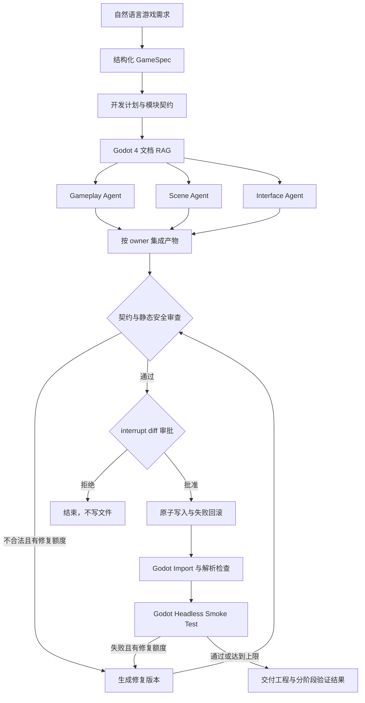

# GodotForge v1.1：可验证的 AI 游戏原型开发 Agent

面向 **Game Jam、独立游戏课程设计与快速原型验证** 的 LangGraph 项目。输入自然语言玩法需求，系统完成结构化设计、模块契约、数据驱动并行开发、diff 审批、工程写入、Godot Import/Smoke Test 和基于错误日志的自动修复，最终交付一个真实 Godot 4 工程。

默认 `DemoGodotModel` 生成一个确定性的 2D 俯视角生存游戏参考实现，不依赖 API Key；切换到 OpenAI 兼容模型后可处理开放式需求。离线模式的价值是复现 Agent 架构和验证闭环，不应被描述为“任意游戏都能生成”。

## 1. 生成的游戏

默认原型《星潮幸存者》包含：

- WASD/方向键控制玩家移动
- 敌人持续生成并追踪玩家
- 接触伤害、生命值与生存计分
- HUD、游戏结束和 Enter 重开
- `--smoke-test` 自动检查玩家、敌人、HUD 和游戏循环

生成文件：

```text
generated/game/
├── project.godot
├── README.md
├── scenes/main.tscn
└── scripts/
    ├── main.gd
    ├── player.gd
    ├── enemy.gd
    └── hud.gd
```

## 2. Agent 工作流



关键实现：

- `src/godot_forge/graph.py`：状态图、并行分支、审批与修复闭环
- `src/godot_forge/nodes.py`：契约设计、动态开发、所有权审查、diff 审批和修复
- `src/godot_forge/models.py`：离线参考模型与 OpenAI/DeepSeek 结构化输出适配器
- `src/godot_forge/templates.py`：可运行 Godot 4 游戏参考实现
- `src/godot_forge/workspace.py`：路径白名单、diff、哈希、原子写入与双阶段引擎验证
- `src/godot_forge/runtime.py`：SQLite 持久化、运行与恢复

## 3. 快速开始

要求 Python 3.11+。当前 Windows 环境：

```bash
cd "11-GodotAgent项目"
python -m venv .venv
.venv/Scripts/python.exe -m pip install -e ".[dev]"
```

macOS/Linux 将 `.venv/Scripts` 替换为 `.venv/bin`。

### 3.1 生成开发方案

```bash
.venv/Scripts/godot-forge.exe run \
  "为 Game Jam 做一个 2D 生存游戏，包含玩家移动、敌人追踪、血量和计分" \
  --thread-id gamejam-demo
```

此时系统返回 7 个拟修改文件、模块契约、内容哈希和 unified diff，暂停在 `approval`，不会提前写入工程。

### 3.2 批准并验证

```bash
.venv/Scripts/godot-forge.exe resume gamejam-demo --approve --note "确认写入 generated/game"
```

批准后系统写入工程，先执行 Import/解析检查，再运行 Smoke Test：

```bash
godot --headless --editor --path generated/game --quit
godot --headless --path generated/game --quit-after 120 -- --smoke-test
```

两个阶段分别记录命令、退出码、日志、错误和耗时；Smoke Test 还要求输出 `SMOKE_TEST_OK`。拒绝修改：

```bash
.venv/Scripts/godot-forge.exe resume gamejam-demo --reject
```

查看持久化状态：

```bash
.venv/Scripts/godot-forge.exe state gamejam-demo
```

## 4. 配置 Godot 4

Agent 按以下顺序查找引擎：

1. `GODOT_FORGE_GODOT_PATH` 指定的可执行文件
2. 项目下的 `tools/Godot.exe`
3. 系统 PATH 中的 `godot` 或 `godot4`

可从 [Godot 官方下载页](https://godotengine.org/download/windows/) 获取标准版，无需 .NET 版本。将 Windows 可执行文件放到 `tools/Godot.exe`，或复制 `.env.example` 为 `.env` 后配置：

```dotenv
GODOT_FORGE_GODOT_PATH=D:/Godot/Godot_v4.7.2-stable_win64.exe
```

找不到引擎时系统会明确返回 `verification.status=skipped`，不会将静态检查冒充为运行成功。

## 5. 切换真实大模型

### DeepSeek

```dotenv
GODOT_FORGE_MODEL_PROVIDER=deepseek
GODOT_FORGE_API_KEY=your-key
```

提供方会自动使用 `deepseek-chat`、`https://api.deepseek.com/v1` 和显式注入 Pydantic JSON Schema 的 JSON 输出模式。也可以显式覆盖 `GODOT_FORGE_MODEL_NAME`、`GODOT_FORGE_BASE_URL` 与 `GODOT_FORGE_STRUCTURED_OUTPUT_METHOD`。

### OpenAI 兼容服务

```dotenv
GODOT_FORGE_MODEL_PROVIDER=openai
GODOT_FORGE_MODEL_NAME=gpt-4o-mini
GODOT_FORGE_API_KEY=your-key
GODOT_FORGE_BASE_URL=https://api.openai.com/v1
```

真实模型通过 `with_structured_output` 生成 `GameSpec`、`DevelopmentPlan` 和 `ArtifactBundle`。即使使用真实模型，路径白名单、危险调用检查、人工授权和最大修复次数仍由确定性代码控制。

## 6. 测试与评估

```bash
.venv/Scripts/python.exe -m ruff check .
.venv/Scripts/python.exe -m pytest
.venv/Scripts/godot-forge.exe evaluate
```

测试覆盖：

- 三个开发 Agent 的动态并行与 reducer 聚合
- 审批前零文件写入、拒绝后零引擎调用
- 工程生成和冒烟协议
- 引擎失败后的有界自动修复
- 路径穿越拦截与写入失败恢复
- SQLite 跨运行时恢复
- FastAPI 完整审批链路
- 检测到便携引擎后执行真实 Godot Headless 测试

另提供 DeepSeek 在线全链路测试，默认跳过。以下命令会真实调用 API 并启动 Godot，密钥只从环境变量读取：

```bash
GODOT_FORGE_RUN_LIVE_TESTS=1 GODOT_FORGE_API_KEY=your-key \
  .venv/Scripts/python.exe -m pytest tests/test_deepseek_live.py -vv -s
```

本项目已用 `deepseek-chat` 完成一次真实在线全链路验收，并通过 Godot 4.7.2 的 `SMOKE_TEST_OK`。这证明被测链路可用，不代表开放式需求的普遍成功率。

评估分别报告工程完成率、审批门禁准确率、文件完整率和**真实引擎验证通过率**。没有引擎时最后一项应为 0，而不是被静态通过结果掩盖。

## 7. FastAPI

```bash
.venv/Scripts/godot-forge.exe serve --host 127.0.0.1 --port 8001
```

接口文档：`http://127.0.0.1:8001/docs`。

- `POST /v1/builds`：创建游戏构建
- `POST /v1/builds/{thread_id}/resume`：批准或拒绝工程变更
- `GET /v1/builds/{thread_id}`：查询计划、修复次数与验证结果
- `GET /health`：健康检查

## 8. 面试知识点

| 知识点 | 落地方式 |
|---|---|
| 多 Agent 契约 | 计划声明职责、owned_paths 和 public_interfaces，审查节点确定性核验 owner |
| 动态并行 | `fan_out` 根据 `plan.modules` 生成 `Send`，reducer 收集并行产物 |
| 可验证生成 | Import 与 Smoke Test 分阶段记录日志、退出码、错误和耗时 |
| 自动修复 | 将真实错误日志回送修复节点，区分局部补丁和全量重建并限制次数 |
| Human-in-the-loop | 写入前展示契约、文件哈希和 diff，通过同一 `thread_id` 审批恢复 |
| 持久化 | SQLite 保存需求、计划、文件内容、授权与验证状态 |
| 安全 | 相对路径白名单、禁止 `OS.execute`、固定进程参数、写入回滚 |
| RAG | Godot 4 项目、物理移动、UI、Headless 和安全文档检索 |
| 评估 | 不只评价文本，直接检查文件集合与游戏运行结果 |

## 9. 学生项目简历表述

> 面向 Game Jam 快速原型场景，基于 LangGraph 设计契约驱动的 Godot AI 开发 Agent，通过模块所有权与公共接口约束多 Agent 并行生成，结合 Godot 4 文档 RAG 和结构化输出工程文件；利用 Import/Headless Smoke Test 与错误日志构建有界修复闭环，并通过 diff 审批、路径白名单、原子写入和 SQLite Checkpointer 提升自动修改的可控性、可审查性与可恢复性。

文档索引：

- `docs/项目学习文档.md`：从数据模型到工作流、验证和动手练习的系统学习材料
- `docs/开源对标与迭代记录.md`：OpenHands、Aider、SWE-agent、LangGraph、Godot MCP 对标与 v1.1 迭代
- `docs/面试指南.md`：三分钟讲解和高频追问

## 10. 边界与后续演进

- 离线模型是固定参考实现；开放式需求需要真实模型并补充更多评估。
- 当前静态审查不是完整安全沙箱。不可信生成代码应在容器或受限虚拟机中运行，并限制文件系统、网络和系统 API。
- 当前验证聚焦“工程能启动且关键对象完成初始化”，还可以扩展截图回归、玩法断言、性能帧率和导出测试。
- 不虚构上线用户、开发效率提升或商业项目经历；用可运行工程和真实测试输出证明项目质量。
